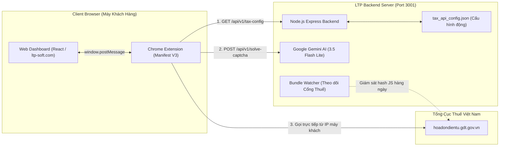

# TÀI LIỆU TỔNG QUAN ỨNG DỤNG & HƯỚNG DẪN BÀN GIAO TÍCH HỢP
## TaxInvoice Sync Module ➔ Hệ Sinh Thái Chấm Công LTP Attendance (ltp-soft.com)

> **Mục đích tài liệu:** Cung cấp thông tin kiến trúc kỹ thuật, luồng dữ liệu, cơ chế bảo mật và giao thức kết nối của module **TaxInvoice Sync** để đội ngũ kỹ thuật/AI Agent phụ trách nền tảng **LTP Attendance (ltp-soft.com)** có thể tích hợp liền mạch vào hệ thống chấm công & quản trị nhân sự hiện tại.

---

## 1. TỔNG QUAN SẢN PHẨM & CHIẾN LƯỢC KINH DOANH (LEAD MAGNET)

### 1.1. Bài toán giải quyết
Kế toán doanh nghiệp tại Việt Nam hàng tháng/hàng quý phải mất hàng giờ để đăng nhập Cổng Thuế (`hoadondientu.gdt.gov.vn`), vượt Captcha, tra cứu thủ công từng trang và gom hóa đơn Mua Vào - Bán Ra vào Excel. Các phần mềm kế toán lớn thường tính phí cao hoặc khó tích hợp.

### 1.2. Mô hình chuyển đổi khách hàng (Growth Funnel cho LTP Attendance)
1. **Phễu Miễn Phí (Lead Magnet):** Cung cấp công cụ tra cứu & xuất Excel 2 sheet **hoàn toàn miễn phí cho 01 Mã Số Thuế đầu tiên**.
2. **Khóa bản quyền (Anti-Bypass):** Khi người dùng muốn tra cứu từ MST thứ 2 trở đi (dịch vụ kế toán, chủ nhiều công ty, chuỗi chi nhánh), hệ thống kích hoạt cơ chế khóa bản quyền lưu trong `chrome.storage.local` (chống xóa cache / chống `Ctrl + F5`).
3. **Cross-Sell Máy Chấm Công:** Pop-up thông báo nâng cấp sẽ điều hướng trực tiếp sang đăng ký sử dụng **Phần mềm Chấm Công Thông Minh LTP Attendance (ltp-soft.com - 0đ/nhân viên, QR Geofence, Offline 100%)** để được tặng bản quyền tra cứu thuế không giới hạn.

---

## 2. KIẾN TRÚC KỸ THUẬT (MONOREPO ARCHITECTURE)

Dự án gồm 3 thành phần liên kết chặt chẽ:

```
e:\auto_voice_tax/
├── extension/             # Chrome Extension (Manifest V3) - Client-side Proxy & Trình thực thi
├── backend/               # Node.js/Express Backend - AI Gemini OCR & Dynamic Config Server
├── frontend-module/       # React + Vite + TailwindCSS + ExcelJS - Giao diện Web Dashboard
└── TaxInvoiceSync_Extension.zip  # Gói cài đặt Extension đã đóng gói sẵn sàng deploy
```



---

## 3. CHI TIẾT CÁC THÀNH PHẦN KỸ THUẬT

### 3.1. Chrome Extension (`extension/`)
* **Công nghệ:** Manifest V3, Service Worker ES Module, Content Script Bridge.
* **Vai trò:** Hoạt động như một **Client-side Proxy**. Mọi truy vấn sang Cổng Thuế đều được gửi từ chính IP máy tính của khách hàng, giải quyết triệt để vấn đề Cục Thuế chặn IP máy chủ (WAF/Cloudflare Block).
* **Bảo mật tuyệt đối (Zero-Server-Storage):** Mật khẩu thuế và token JWT chỉ nằm trong RAM của Extension lúc chạy, **không bao giờ gửi lên server**.
* **Chống gian lận 1 MST (`Ctrl + F5` immune):** Danh sách MST đã tra cứu được lưu vào `chrome.storage.local`. Khách hàng bấm F5, xóa cache web hay xóa cookie đều không thể reset được giới hạn này.
* **Cơ chế Captcha Độc Lập Luồng Máy Tính Tiền (Zero-Miss POS):**
  - Tự động gọi hàm `getFreshCaptchaForPos()` trước khi quét luồng HĐ Máy tính tiền (`/sco-query/invoices/purchase` và `/sold`).
  - Giải quyết triệt để lỗi Cục Thuế báo `Mã captcha không đúng` và `504 Gateway Timeout`. Thu thập 100% hóa đơn ăn uống, khách sạn, vé xe, siêu thị của nhân viên.

### 3.2. Backend AI & Dynamic Config (`backend/`)
* **Công nghệ:** Node.js, Express, `@google/genai` (SDK chính thức của Google DeepMind).
* **Mô hình AI:** Mặc định sử dụng **`gemini-3.5-flash-lite`** (thời gian phản hồi cực nhanh ~1.5 giây để giải mã Captcha SVG).
* **Endpoints chính:**
  - `GET /api/v1/tax-config`: Trả về toàn bộ file cấu hình đường dẫn API, template query, field mapping và từ điển trạng thái hóa đơn.
  - `POST /api/v1/solve-captcha`: Nhận ảnh Captcha SVG/Base64 ➔ Gemini AI giải mã ➔ Trả về mã ký tự chính xác.
  - `POST /api/v1/heal-schema`: Nhận dữ liệu mẫu bị lệch cấu trúc ➔ Gemini AI suy luận và tự động vá file cấu hình.
* **Cơ chế Zero-Update (Chống Cục Thuế đổi API):**
  - Extension không hardcode endpoint. Mọi đường dẫn và tên trường được kéo động từ `backend/src/config/tax_api_config.json`.
  - Khi Cục Thuế đổi đường dẫn API hoặc đổi tên trường, chỉ cần sửa 1 dòng trên Backend hoặc để Gemini tự Auto-Heal. Toàn bộ Extension của khách hàng tự động cập nhật ngay lập tức mà không cần update trên Chrome Web Store!

### 3.3. Web Dashboard Frontend (`frontend-module/`)
* **Công nghệ:** Vite, React 19, TailwindCSS v4, Lucide React, ExcelJS.
* **Tính năng nổi bật:**
  - **Quản lý đa MST:** Lưu trữ cục bộ an toàn, gắn nhãn công ty.
  - **3 Chế độ tra cứu:**
    + **Theo Quý (Quý 1, 2, 3, 4):** Tự động chia thành 3 tháng và quét vét cạn không bỏ sót.
    + **Theo Tháng (Tháng 1 đến Tháng 12):** Đối soát nhanh từng tháng riêng biệt.
    + **Khoảng ngày tùy chọn:** Từ ngày ... đến ngày ...
  - **Bộ Lọc Thông Minh Smart Date:**
    + Tự động bù trừ chênh lệch múi giờ UTC của Cục Thuế sang **Giờ Việt Nam (GMT+7)** (khắc phục triệt để việc hóa đơn lập lúc 00:00 ngày 01/10 bị hiển thị thành ngày 30/09).
    + Tự động loại trừ các hóa đơn lập sai kỳ (ví dụ hóa đơn xuất ngày 30/09 lọt vào Quý 4) để bảo vệ số liệu kê khai chính xác cho kế toán.
  - **Xuất Excel Chuẩn Kế Toán (Kèm Công Thức Động):**
    + Xuất file 2 sheet: `Mua_Vao` và `Ban_Ra`.
    + Dòng tổng cộng 1: Sử dụng công thức thực `=SUM(J6:J...)`.
    + Dòng tổng cộng 2 (Hợp lệ kê khai thuế GTGT): Sử dụng công thức kiểm toán `=SUMIF($Q$6:$Q$..., "Hợp lệ", J$6:J$...)` tự động trừ đi các hóa đơn đã bị hủy/thay thế.
  - **Chứng nhận bảo mật chuẩn Ngân hàng (Bank-Grade Privacy):** Khẳng định cam kết 100% Client-Side để tạo dựng niềm tin tuyệt đối cho doanh nghiệp.

---

## 4. GIAO THỨC GIAO TIẾP DỮ LIỆU (COMMUNICATION PROTOCOL)

Khi tích hợp vào website `ltp-soft.com`, Web và Extension giao tiếp qua `window.postMessage`:

### 4.1. Web gửi lệnh bắt đầu đồng bộ sang Extension
```javascript
window.postMessage({
  type: 'TAX_EXTENSION_START_SYNC',
  requestId: Date.now().toString(),
  payload: {
    username: '0110582230',        // Mã số thuế
    password: 'Mật_Khẩu_Thue',      // Mật khẩu trang thuế (chỉ nằm ở client)
    quarter: '4',                   // '1' | '2' | '3' | '4' (hoặc null nếu chọn theo tháng)
    month: null,                    // '1'..'12' (hoặc null nếu chọn theo quý)
    year: '2025',                   // Năm tra cứu
    from_date: null,                // 'dd/mm/yyyy' (nếu chọn khoảng ngày)
    to_date: null,                  // 'dd/mm/yyyy'
    strict_period: true,            // Bật bộ lọc Smart Date GMT+7
    include_pos: true,              // Quét vét cạn cả HĐ Máy tính tiền
    backend_url: 'http://localhost:3001', // URL Backend API (đổi sang domain production)
    license_key: 'free-lead-magnet' // Hoặc mã bản quyền PRO của LTP
  }
}, '*');
```

### 4.2. Extension phát sóng tiến độ theo thời gian thực (Progress Stream)
```javascript
// Web Dashboard lắng nghe sự kiện:
window.addEventListener('message', (event) => {
  if (event.data?.type === 'TAX_EXTENSION_PROGRESS') {
    const { stage, step, percent, purchase_count, sold_count } = event.data.data;
    console.log(`[Tiến độ: ${percent}%] ${step}`);
  }
});
```

### 4.3. Extension trả về kết quả cuối cùng
```javascript
// Sự kiện: TAX_EXTENSION_SYNC_RESULT
{
  type: 'TAX_EXTENSION_SYNC_RESULT',
  response: {
    success: true,
    data: {
      purchase: [ /* Danh sách HĐ Mua Vào */ ],
      sold: [ /* Danh sách HĐ Bán Ra */ ]
    },
    summary: {
      mst: '0110582230',
      period_label: 'Quý 4/2025',
      count_purchase: 45,
      count_sold: 120,
      valid_count_purchase: 43,
      valid_count_sold: 120,
      total_amount_purchase: 1250000000,
      total_amount_sold: 3400000000,
      total_tax_purchase: 125000000,
      total_tax_sold: 340000000,
      out_of_period_count: 2 // Số hóa đơn lệch ngày đã tự loại trừ
    }
  }
}
```

---

## 5. KẾ HOẠCH TÍCH HỢP VÀO NỀN TẢNG CHẤM CÔNG LTP ATTENDANCE

Để Antigravity bên dự án Máy Chấm Công (`ltp-soft.com`) tiếp nhận và phát triển tiếp:

### Bước 1: Triển khai Subdomain `tax.ltp-soft.com`
- Đưa thư mục build [`frontend-module/dist`](file:///E:/auto_voice_tax/frontend-module/dist) lên hosting hoặc cấu hình reverse proxy Nginx cho domain `tax.ltp-soft.com`.
- Chạy backend daemon bằng PM2 trên server:
  ```bash
  cd backend
  pm2 start src/app.js --name "tax-backend"
  ```

### Bước 2: Liên kết tài khoản khách hàng LTP Attendance
- Trong bảng điều khiển của khách hàng tại `tencongty.ltp-soft.com`:
  - Thêm một menu: **"Hóa Đơn Thuế & Kế Toán (Miễn Phí)"**.
  - Nhúng trực tiếp iframe hoặc chuyển hướng sang `tax.ltp-soft.com`.
  - Khách hàng đã mua gói Chấm Công (STARTER / PRO / ENTERPRISE) sẽ được hệ thống cấp 1 `license_key`. Khi truyền license key này vào tiện ích, người dùng sẽ được **mở khóa tra cứu không giới hạn MST**.

### Bước 3: Đưa Extension lên Chrome Web Store
- File đóng gói sẵn: [`TaxInvoiceSync_Extension.zip`](file:///E:/auto_voice_tax/TaxInvoiceSync_Extension.zip).
- Nộp lên **Google Chrome Web Store Developer Console** với mức phí $5 (đóng 1 lần duy nhất).
- Sau khi được duyệt, thay thế nút cài đặt trên web thành link trực tiếp từ Cửa hàng Chrome.

---

## 6. DANH SÁCH FILE CỐT LÕI CẦN BẢO VỆ & LƯU Ý KHI CODE

| Đường dẫn file | Vai trò cốt lõi | Lưu ý đặc biệt |
| :--- | :--- | :--- |
| `backend/.env` | Chứa `GEMINI_API_KEY` và `PORT=3001` | Cần bảo mật API Key, không push lên git công khai. |
| `backend/src/config/tax_api_config.json` | Cấu hình động toàn bộ Cổng Thuế | Sửa file này là cập nhật toàn bộ Extension từ xa. |
| `backend/src/services/gemini.service.js` | Module AI OCR Captcha & Auto-Heal | Sử dụng model `gemini-3.5-flash-lite`. |
| `extension/background.js` | Service Worker quản lý xác thực & vét cạn | Có logic cấp Captcha độc lập cho POS và kiểm soát 1 MST miễn phí. |
| `extension/interceptor.js` | Bắt lệch cấu trúc & Ẩn danh dữ liệu | Tuyệt đối không xóa phần sanitize dữ liệu trước khi gửi AI. |
| `frontend-module/src/utils/excelExporter.js` | Xuất file Excel 2 sheet | Chứa công thức `=SUM()` và `=SUMIF()` chuẩn kiểm toán. |
| `frontend-module/src/components/SyncControlPanel.jsx` | Bảng điều khiển tra cứu | Tích hợp bộ chọn Quý, Tháng, Ngày và cờ Smart Date GMT+7. |

---
*Tài liệu được tổng hợp hoàn chỉnh sẵn sàng cho việc bàn giao và tích hợp hệ thống.*
